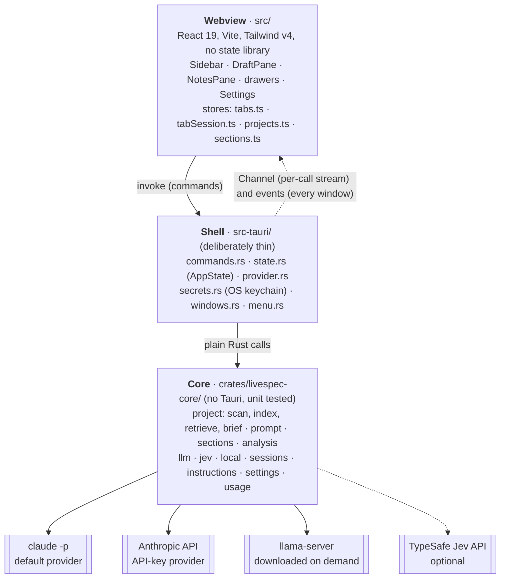
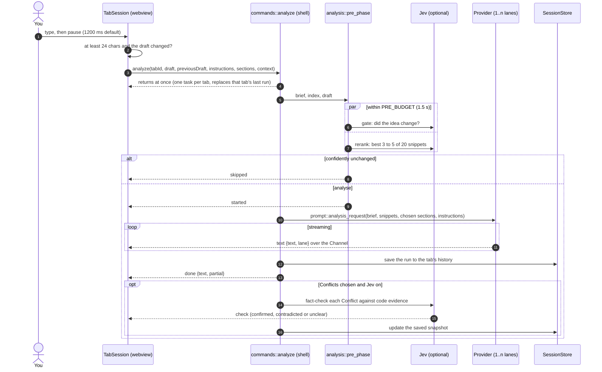
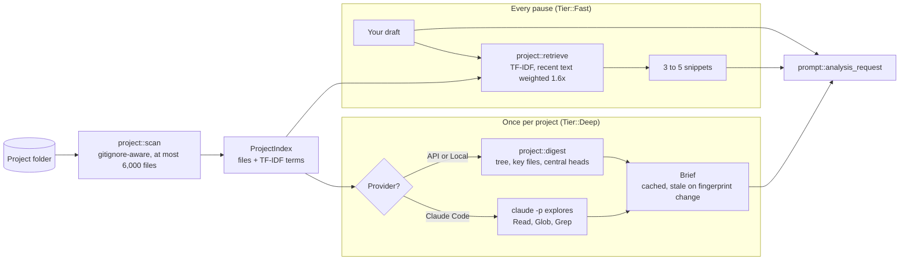

# Architecture

Live Spec is a desktop app for the first step of spec-driven development: writing the spec. You write on the left. When you pause, a model that has read your project reviews the spec against the code and streams notes into the right-hand panel: what the spec asks for, where it conflicts with the code, what an implementing agent would still have to discover, which words it would have to guess at, and the questions that would change the spec most. The goal is a spec you can hand to a coding agent so it can start changing the right files without exploring or guessing first.

This document explains how the app is built. [SETUP.md](SETUP.md) covers installing and running it. [AGENTS.md](AGENTS.md) holds the rules and cross-language contracts that every change must respect.

## Contents

- [At a glance](#at-a-glance)
- [Repository layout](#repository-layout)
- [The three layers](#the-three-layers)
- [What happens when you pause typing](#what-happens-when-you-pause-typing)
- [Note sections](#note-sections)
- [How Live Spec understands a project](#how-live-spec-understands-a-project)
- [Providers](#providers)
- [Jev (TypeSafe)](#jev-typesafe)
- [Tabs, windows and history](#tabs-windows-and-history)
- [The UI](#the-ui)
- [Persistence](#persistence)
- [Security model](#security-model)
- [Errors](#errors)
- [Design decisions](#design-decisions)
- [Known limits](#known-limits)
- [Where to change things](#where-to-change-things)

## At a glance



Three facts shape everything else:

1. **Live analysis is stateless.** Every pause is a fresh, single-turn model call with the spec, the project brief and a few retrieved snippets. Nothing accumulates in a conversation. The saved history is for you to browse and is never sent back to the model.
2. **The core never depends on Tauri.** Scanning, retrieval, prompts, providers, sessions and the local runtime are plain Rust with unit tests. The shell only wires commands, state and the keychain.
3. **Tab state lives outside React.** Each tab's analysis runs in a `TabSession` object that keeps its own pause timer and in-flight run, so a tab you switch away from still gets its notes.

## Repository layout

```
.
├── src/                          React UI
│   ├── App.tsx                   settings and which drawer is open; nothing else
│   ├── components/               DraftPane, NotesPane, Sidebar, TabRow, drawers, dialogs, ui.tsx primitives
│   ├── lib/                      stores and pure logic (tabs, sessions, sections, history, usage, ipc)
│   └── styles.css                Tailwind v4 theme and semantic colour tokens
├── src-tauri/                    Tauri v2 shell (package `livespec`, lib `livespec_lib`)
│   ├── src/commands.rs           every IPC command
│   ├── src/state.rs              AppState: settings, loaded projects, running tasks
│   ├── src/provider.rs           settings → a ready-to-call provider
│   ├── src/secrets.rs            OS keychain access
│   ├── src/windows.rs, menu.rs   runtime windows and the native menu
│   ├── capabilities/default.json what the webview may call
│   └── tauri.conf.json           product name, identifier, CSP, bundle
├── crates/livespec-core/         the core library
│   ├── src/project/              scan, terms, retrieve, brief, digest, explore
│   ├── src/llm/                  ClaudeCli, AnthropicApi, OpenAiCompat, shared SSE parser
│   ├── src/local/                llama.cpp runtime install, model catalog, resumable downloads
│   ├── src/jev/                  TypeSafe client: gate, rerank, fact-check, key lookup
│   ├── src/sessions/             tabs, windows, saved analyses
│   ├── src/prompt.rs             everything the model sees
│   ├── src/sections.rs           the note-section catalogue
│   ├── src/analysis.rs           the pre-phase and lane merging
│   ├── tests/                    live tests (ignored by default; network or subscription)
│   └── examples/probe.rs         prints what retrieval would pick for a draft
└── docs/superpowers/             design specs and implementation plans
```

## The three layers

| Layer | Path | Owns | Rules |
|---|---|---|---|
| UI | `src/` | Rendering, typing pauses, per-tab sessions, draft saving | No state library: module stores read with `useSyncExternalStore`. Model output renders only through `MiniMarkdown` |
| Shell | `src-tauri/` | IPC commands, `AppState`, provider resolution, keychain, windows, menu | Thin. No tests here, so logic worth testing moves to the core |
| Core | `crates/livespec-core/` | Project understanding, prompts, providers, local runtime, sessions, usage ledger | Must not depend on Tauri |

**How they talk.** The webview calls commands with `invoke`. A long-running command (analysis, brief build, downloads) returns as soon as it has spawned its task, then streams progress over a Tauri `Channel` that belongs to the calling window. Facts that every window needs (a brief finished, a tab moved, usage changed) go out as app-wide events. There is no code generation between Rust and TypeScript: `src/lib/ipc.ts` mirrors the serde types by hand, and [AGENTS.md](AGENTS.md#cross-language-contracts-no-codegen-keep-in-sync-by-hand) lists every pair that must change together.

**Long-running work.** Analysis, brief builds and downloads all follow one pattern: spawn a task, keep its handle in an `AppState` slot, stream over a Channel, then send a final `done` or `error`. Replacing or cancelling the slot aborts the task, and dropping the task's future kills any `claude` child it started (`kill_on_drop`).

## What happens when you pause typing



The fact-check actually starts as soon as the lane carrying Conflicts finishes, so with several lanes it can overlap the others and its results can arrive before `done`.

1. **The pause.** Each tab's `TabSession` (`src/lib/tabSession.ts`) waits for a typing pause (`debounceMs`, 1200 by default), whether or not the tab is shown. It needs at least 24 characters after whitespace normalization and skips the call if the normalized draft hasn't changed. Its context key changes when the project, the brief or the instructions do. When that happens the shown tab re-reads the same draft without the gate, and a hidden tab waits until it's shown.
2. **The context key.** `analysisContextKey` (`src/lib/instructions.ts`) is the root, the brief's `createdAt` and the session instructions. A tab adds `|<ids>` only when its sections differ from the default (`tabContextKey`), so tabs saved before sections existed keep their key. The key is stored with each saved analysis, which is how relaunching knows not to re-run a tab whose notes are current. `src/lib/projects.ts` hands a project's key to its tabs only once both its summary and its instructions have loaded, because a key computed earlier (`root|0|`) would differ from the saved one and start a run at launch.
3. **The call.** `analyze` (`src-tauri/src/commands.rs`) checks that the tab is open, spawns a task into `AppState.analyses` keyed by tab id, and returns. A new run for a tab aborts only that tab's previous one, so tabs analyse in parallel. `cancel_analysis` and `close_tab` abort it too. The task takes the index and brief for the tab's root from `AppState.projects`. A tab with no project, or whose folder can't be read, runs without code context.
4. **The pre-phase.** The task resolves a provider at `Tier::Fast` and runs `analysis::pre_phase`. The Jev gate and the Jev rerank run concurrently under `PRE_BUDGET` (1.5 s). A confident "unchanged" emits `skipped` and stops. Without Jev, for the Local provider, or when Jev is slow or failing, it falls back to plain keyword retrieval (`project::retrieve`).
5. **The prompt.** `sections::resolve` turns the tab's section ids into the chosen sections (unknown ids are dropped, and nothing known means the whole catalogue). `prompt::analysis_request` builds the request. The session instructions go into every lane's system prompt before the rules, clipped to `min(MAX_INSTRUCTION_CHARS, budget / 10)` characters.
6. **Streaming.** The sections are written by `Settings::effective_note_agents()` lanes at once (1 unless parallel notes is on, and always 1 for Local). `prompt::section_groups(n, &chosen)` splits the sections into at most `n` contiguous groups. Lanes run through `agents::run_limited`. Every chunk reaches the webview as `text { text, lane }`, and `src/lib/lanes.ts` joins the lane buffers in lane order.
7. **Done.** `done { text, partial }` carries the lanes joined in order (`analysis::merge_lanes` keeps only each lane's own sections). Missing sections become one `notice` with `partial: true`, and the UI offers *Try again*. Partial notes never become the gate's comparison point. Before `done` is sent, `sessions::Recorder` saves the run to the tab's history. A failed save becomes a notice and never fails the analysis.
8. **Fact-check.** When the lane carrying Conflicts finishes (a oneshot from that lane), `jev::check::run` starts concurrently with the other lanes. There's no `checking` event when Conflicts isn't chosen, and `done` never waits for it. Later checks, notices and `checksStopped` update the saved snapshot (`update_snapshot`). The next keystroke aborts them with the rest of the task. Skips and errors save nothing.

Events on the Channel: `text`, `activity`, `started`, `skipped`, `notice`, `checking`, `check`, `done`, `error`, `progress`.

## Note sections

The notes come from a five-entry catalogue in `crates/livespec-core/src/sections.rs`, mirrored in `src/lib/sections.ts`:

| Id | Shown as | What the model is asked for |
|---|---|---|
| `intent` | Intent | What the spec asks for, for whom, and what done looks like; if the spec doesn't say, what it fails to say |
| `conflicts` | Conflicts with code | Where the spec contradicts how the project works, re-does something that exists, or assumes wrongly, citing file paths. Fact-checked when Jev is on |
| `gaps` | Gaps | What an implementing agent would need but can't find: acceptance criteria it could turn into tests, non-goals, error and edge cases, missing data or state, commands to run |
| `ambiguities` | Ambiguities | Phrases an agent would have to guess at, quoted, with both readings and a precise rewording |
| `questions` | Questions for you | One to three questions whose answers would most change the spec |

The model writes the short headings (`## Conflicts`, `## Questions`), and the UI shows the longer titles. The `guide` text of each `SectionSpec` is what goes into the system prompt.

- **Per tab.** Each tab stores its chosen ids in `Tab.sections`. An empty list means the default set. The *Sections ▾* menu above the notes edits it through `set_tab_sections`, and a new tab on the same project copies the shown tab's choice.
- **Templates carry sections.** A `Template` has text and a section set. Applying one in the Instructions drawer also switches the shown tab's sections, and Undo restores both. An empty set leaves the tab's sections alone.
- **One prompt, one parser.** The prompt asks for exactly the chosen sections. `src/lib/sections.ts` splits the streamed Markdown back into them, and `prompt::section_body` does the same in Rust for the fact-check. Both accept `**Conflicts:**`, `### Conflicts with code` and the old build's `## Faults`. The TypeScript side also renders the old `## Directions`, display-only, so saved notes from earlier versions still show.
- **Adding a section** means one `SectionSpec` in `CATALOGUE` and a matching entry in `SECTIONS`. The prompt, the lanes, the picker and the parser follow.

## How Live Spec understands a project

Like a new teammate, it reads the project once in depth, then looks up the relevant code each time you write.



### The brief (once per project)

`build_brief(root)` runs at `Tier::Deep`, with one build per project at a time (`AppState.brief_tasks`, keyed by root).

- **With Claude Code**, Claude explores the repo itself with read-only tools (`Read,Glob,Grep`, up to 20 turns) and writes an onboarding brief for the notes model.
- **With the API or a local model**, the model gets a budgeted digest instead (`project::digest`): the file tree, key files (README, CLAUDE.md, AGENTS.md, ARCHITECTURE.md, manifests), then the heads of the most central source files.
- **Parallel exploration** (`agents.parallelBrief`, off by default). With more than one agent and at least 40 indexed files, `project::explore::slices` splits the files into balanced slices, explorers map them at once (activity shows as "Agent k" in the drawer), and one merge call writes the brief. Measured on this repo, 4 explorers plus the merge took about 16% longer than one explorer, so it stays off.

Briefs are cached at `<app_data>/briefs/<fnv(root)>.json` and marked stale when the project fingerprint changes. On success the task saves the brief, rescans the project, and emits `brief-status { root, state: done }` to every window. Only the window that started the build receives the live text.

### Retrieval (every pause)

TF-IDF over identifier terms, with no embeddings. `project/terms.rs` splits camelCase and snake_case, folds plurals and drops stopwords. The same tokenizer runs at index time and query time. The last 400 characters of the draft weigh 1.6×, and matches in a file's path get a bonus. Retrieval takes microseconds and works offline. `cargo run -p livespec-core --example probe -- <dir> "<draft>"` shows what it would pick.

### Scanning and loaded projects

`project::scan` honours `.gitignore` even outside git (`require_git(false)`), skips hidden files and `SKIP_DIRS`, and indexes at most 6,000 text files of 256 KB or less. The fingerprint hashes the path, size and mtime of every non-ignored file with the in-house FNV-1a (`project::Fnv`), because `DefaultHasher` isn't stable across Rust versions.

`AppState.projects` holds one `ProjectEntry { index, brief }` per root, so tabs on several projects analyse at once. `open_project` always rescans. `project_summary` scans only a root that isn't loaded. An index keeps file contents in memory, so after `close_tab` and `delete_tab` the shell drops every entry no open tab uses (`AppState::evict_unused_projects`).

## Providers

`llm::Provider` is a closed enum (`ClaudeCli | AnthropicApi | OpenAiCompat`) dispatched with `match`. All three take the same `ChatRequest` and ignore fields they can't use.

| Provider | How it runs | Auth | Notes |
|---|---|---|---|
| **Claude Code** (default) | The user's own `claude -p --output-format stream-json`, prompt on stdin | The user's Claude Code login, or a keychain API key passed as `ANTHROPIC_API_KEY` in the child's environment | `--restricted` and `--strict-mcp-config` on every run. Live analysis uses no tools and replaces the system prompt; the brief allows `Read,Glob,Grep` and appends to Claude Code's own prompt |
| **Anthropic API** | HTTPS + SSE (`llm/sse.rs`) | API key in the OS keychain | Sends `output_config.effort` only when a level is set |
| **Local** | `llama-server` from a pinned llama.cpp build, OpenAI-compatible API | None | Runtime and GGUF models downloaded in-app; nothing leaves the machine |

- **Tiers.** `Tier::Fast` (live notes) and `Tier::Deep` (brief) each have their own model and effort level in Settings.
- **Claude Code details.** Tools come from an allowlist via `--tools`, never a denylist. The NDJSON parser ignores unknown event types so CLI upgrades don't break it. The final answer comes from the `result` event, which excludes narration streamed during exploration. `--restricted` ignores every Claude Code settings file, including the user's own, so `apiKeyHelper` and settings `env` blocks don't apply (see [SETUP.md](SETUP.md#claude-code-and-restricted-mode)).
- **Local runtime.** `provider::ensure_local` starts `llama-server` in its own task, because analysis tasks are aborted on every keystroke and an abort mustn't kill a model that is halfway through loading. The server stops on exit and when you switch away from Local.
- **Budgets.** `Provider::context_budget_chars()` sizes every prompt: 120k characters for Claude, `context_tokens × 1.5` for local models. The brief is clipped to 3/5 of the budget and snippets get 1/4. Drafts over 12k characters keep the first 2k plus the tail.
- **Usage.** Each provider ends a call it has usage for with `Chunk::Usage`, one per model. Claude Code's comes from `result.modelUsage` (`costUSD`, falling back to `usage` plus `total_cost_usd`, then to `usage::PRICES`) and is reported for failed runs too. The API's comes from `message_start` plus the last `message_delta`. The local server's comes from its final chunk (requested with `stream_options.include_usage`; the pinned `llama-server` b11480 reports it, so local runs are exact) at $0. `usage::metered` wraps every call and records it in the ledger. A call cut short records an estimate from `Meter::drop` (`ceil(chars / 4)` tokens at list price, counted in `estimatedRuns` and shown with "~"), as does a call that succeeds without usage; a call that fails without usage records nothing. A run still going when the app quits isn't recorded, because Tauri exits the process after the `Exit` callback and `Meter::drop` never runs. Jev calls aren't counted.

## Jev (TypeSafe)

`livespec-core::jev` is a typed client for TypeSafe's System One API. Jev judges and never writes text. It's optional, needs a TypeSafe key, and never runs with the Local provider, because that would send code off the machine.

| Feature | When | What it does | On failure |
|---|---|---|---|
| **Gate** | Before each run | "Did the idea change since the last completed analysis?" A confident no skips the run | Analyse anyway |
| **Rerank** | Before each run | Scores the 20-snippet keyword shortlist and keeps the best 3 or 5 | Keyword order |
| **Fact-check** ("Checked in code") | After the Conflicts lane | Finds evidence in the index for each Conflict bullet (backticked names and paths, matched as whole identifiers), then asks Jev: supports, contradicts or says nothing. ✓ and ✗ need confidence ≥ 0.8 | One notice; notes unaffected |

A Jev request is one `state` plus any number of Noul (yes-probability) or Choice questions. Choice options serialize in the order given (`jev::Options`), because Jev 1.13 can lean towards the first option. For the fact-check, a name found in more than `min(8, files / 4)` files (at least 2) is too generic to count as evidence. The client retries 429, 503 and 529 twice. The gate and rerank never add more than `PRE_BUDGET` before the model call. The key is looked up in the keychain, then `TYPESAFE_API_KEY` in the environment, then (debug builds only) `.env.local`. It never crosses IPC: the webview only learns which source supplied it.

## Tabs, windows and history

- **The store.** `src/lib/tabs.ts` is the window's tab store: the `WindowView` from `list_workspace`, the shown tab, and one `TabSession` per tab shown since launch. It refetches on every `workspace-changed` event.
- **Projects.** `src/lib/projects.ts` caches each project's summary, instructions and brief builds for the window. A context change on a hidden tab only sets `contextDirty`, and `activate()` runs it when the tab is shown, so a rebuilt brief or edited instructions re-run only the tab on screen.
- **Drafts.** Edits save through one `createSaver` keyed by tab id (500 ms after typing stops), flushed on a tab switch, before closing a tab and on `pagehide`.
- **The sidebar.** Tabs are grouped by project in order of first appearance (`groupTabs` in `src/lib/tabList.ts`). Tabs without a project sit under "No project", and two projects with the same folder name also show their parent folder. A tab's title is its name, else the first line of its draft, else "Untitled". ⌃Tab and ⌃⇧Tab follow this visual order, and closing the shown tab shows the next one in it (the previous one when it was last). A folded project group shows a pulsing dot (`animate-pulse-dot`) while any of its tabs is analysing.
- **History.** Each tab keeps its last `HISTORY_LEN` (5) analyses, newest first. `TabSession.view(index)` browses them (0 is the live state, k ≥ 1 is `history[k]`). `done` refetches the history with `get_tab`, and `started` goes back to the latest. `NotesPane` shows `‹ 2 of 5 ›` and the time (`historyPosition` and `snapshotTime` in `src/lib/history.ts`, hidden with fewer than two). An older analysis renders read-only through `snapshotAnalysis` under "Notes on an earlier draft.", with its draft behind *Show that draft*.
- **Windows.** Each window is a workspace window labelled `w-<n>`, built in Rust only (`windows.rs`). Tabs can move between windows (`move_tab`): the pending draft saves first, the backend moves the tab and stops its run, then the old window drops it. Settings, instructions and templates are shared by every window, and the last save wins (`src/lib/crossWindow.ts`).
- **Closed tabs.** A closed tab is any tab file no window lists, so there's no separate closed list to drift. *Recently closed* is shared by every window, grouped by project and sorted by `closedAt`, else `updatedAt`.

## The UI

- **Layout.** `main` is a three-column grid: sidebar (248 px), draft (3fr), notes (`minmax(320px, 2fr)`). Each pane scrolls on its own. The draft textarea centres a 40rem column with percentage padding so the text and the word-count footer line up. ⌘\\ hides the sidebar (`display: none`, so the grid drops to two columns). A window narrower than 1,100 px starts with it hidden unless you chose otherwise in that window (`readCollapsed` / `writeCollapsed` in `src/lib/tabList.ts`).
- **Styling.** Tailwind v4 through `@tailwindcss/vite`, with the theme in `src/styles.css` and no `tailwind.config`. Colours are semantic tokens (`bg-page`, `text-ink`, `text-fault`, …) that switch under `prefers-color-scheme: dark`. Note colours carry meaning: conflicts red, gaps blue, ambiguities and questions amber.
- **Fonts.** Bundled from Fontsource, never fetched, because the app works offline and the CSP allows only `'self'`. Your spec is set in Literata, the notes and UI in Inter, code in JetBrains Mono.
- **Primitives.** `src/components/ui.tsx` holds `Button`, `Field`, `Menu` (a popup menu at a point; Esc, a click outside or the window losing focus closes it), `Select`, `Eyebrow`, `RULE` and `cx`. `Select` is a select-only combobox styled like `Menu`; its list is portalled into the enclosing `<dialog>`, else `<body>`, its Esc never closes the drawers or Settings, and its key handling lives in `src/lib/listbox.ts`.
- **The rule.** The accent rule between the panes and the 2 × 28 px rule on each sidebar row share the state classes in `RULE`: solid when the notes are current, animated while thinking, dashed when the draft has moved on, an empty track when idle (also a tab not shown since launch). `ruleState` and `statusLine` in `src/lib/tabStatus.ts` derive both from a tab's view. Under reduced motion the rule is static, and the row's status line ("Analysing…", "Draft moved on", "Notes current", or the error) carries the state.
- **Shortcuts.** One `keydown` listener per window (`src/lib/actions.ts`). The native menu (`livespec-core::menu`, built in `src-tauri/src/menu.rs`) sends the same action ids.
- **Dialogs.** Settings is a native `<dialog>` opened with `showModal()`. Only one drawer is open at a time. Destructive actions ask inline, never with `confirm()`.

## Persistence

Everything lives in the OS's per-app folders for the identifier `app.livespec.desktop`. JSON files are written atomically (temp file and rename). A file that doesn't parse is kept as `.bad`, `.bad.1`, … rather than overwritten, because it may hold the user's writing.

| What | Where | Notes |
|---|---|---|
| Settings | `<app_config>/settings.json` | Missing or corrupt falls back to defaults. Unknown enum values fall back per field |
| Instructions and templates | `<app_config>/instructions.json` | Keyed by project root; `""` is the no-project session. Starts with five starter templates |
| Tabs and windows | `<app_data>/sessions/workspace.json`, `sessions/tabs/<id>.json` | Each tab file holds its root, title, draft, sections and last 5 analyses |
| Briefs | `<app_data>/briefs/<fnv(root)>.json` | Stale when the project fingerprint changes |
| Usage | `<app_data>/usage.json` | Hourly UTC buckets, written at most every 5 s, pruned to 90 days |
| Local runtime and models | `<app_data>/local/{runtime,models,downloads}` | Downloads resume through `.part` files and HTTP Range requests. Runtime installs extract into a staging folder, then swap it in. Server log at `local/llama-server.log` |
| API keys | OS keychain, service `app.livespec.desktop` | Accounts `anthropic-api-key` and `typesafe-api-key`; never in a file, never sent to the webview |
| Sidebar shown or hidden | webview `localStorage`, `livespec.sidebar.<windowId>` | Per window |

**Upgrades from LiveBrainstorm.** The app was called LiveBrainstorm (`app.livebrainstorm.desktop`). On launch, `migrate::move_app_dirs` renames the old folder into place when the new one is missing or empty (with a copy fallback that keeps the old one), and `secrets::migrate_from_old_service` copies the keychain entries once per install (marker `.keychain-migrated`), so a key removed later stays removed. Neither deletes anything or fails the launch. On the first launch of a build with tabs (`WindowView.fresh`), drafts the earliest build kept in `localStorage` become tabs through `import_legacy_drafts`, which runs once; the keys are removed only after it succeeds.

## Security model

- **No Claude subscription credentials.** Anthropic permits subscription OAuth only inside Claude Code and claude.ai, so Live Spec only ever runs the user's own `claude` binary and never reads its token files.
- **Opened repos can't run code.** `--restricted` stops a project's hooks and settings from running, `--strict-mcp-config` loads no MCP servers, and tools come from an allowlist: none for live notes, read-only for the brief.
- **Keys stay in Rust.** API keys live in the OS keychain and travel as `llm::Secret`, whose `Debug` prints `Secret(***)`. A key reaches `claude` only through its environment, never argv. The TypeSafe key is never named `VITE_*`, because Vite ships those to the webview.
- **Model output is untrusted.** It renders only through `MiniMarkdown` (React elements, never `innerHTML`), behind a strict CSP (`default-src 'self'`).
- **Ids are validated.** Every tab or window id from the webview must match `^[tw]-[0-9a-f-]{1,40}$` (`sessions::valid_id`) before use, because a tab id becomes a file name.
- **Narrow capabilities.** `src-tauri/capabilities/default.json` grants the `w-*` windows `core:default`, the folder picker, setting their own title and closing themselves. Windows are created in Rust, never by the webview.
- **Local stays local.** Jev never runs with the Local provider.

## Errors

`livespec_core::Error` serializes as a plain string across IPC. `Precondition` means the user must act (open a project, install Claude Code, download a model), and the UI shows its message verbatim, so it's written as an instruction. `Provider` means the model, the CLI or the network failed.

## Design decisions

- **Enum dispatch for providers.** Three known providers, so `match` beats `dyn Trait` with `async_trait` boxing.
- **A fresh `claude -p` per pause.** A persistent stream-json session would start faster but would accumulate conversation history.
- **Parallel lanes and explorers are off by default.** Measured with Claude Code, 4 note lanes finished slower than 1 (per-call start-up dominates) while using 4× the subscription, and 4 brief explorers plus a merge took about 16% longer than one.
- **llama.cpp downloaded at runtime, version pinned.** `llama-server` ships with shared libraries a single-binary sidecar can't carry. The build is pinned (`LLAMA_CPP_BUILD`) for reproducibility. CPU builds everywhere except macOS, where Metal is built in.
- **GUI `PATH` fix.** Apps launched from Finder don't inherit the shell `PATH`, so `shell_env::login_shell_path` asks the login shell once (4 s timeout) to find `claude` and `node`.
- **OS certificate store.** reqwest uses `rustls-tls-native-roots`, so corporate TLS-inspecting proxies work.

## Known limits

- Each Claude Code analysis spawns a new process, adding a second or two of start-up.
- At most 6,000 text files of 256 KB each are indexed. With Claude Code the brief still covers the rest.
- Model download URLs point at Hugging Face.
- Release builds are Apple Silicon only and ad-hoc signed, so macOS asks you to confirm the first launch (see [SETUP.md](SETUP.md#install-the-app)).

## Where to change things

| To change | Look in |
|---|---|
| What the model sees | `crates/livespec-core/src/prompt.rs` |
| The note sections | `sections::CATALOGUE` and `SECTIONS` in `src/lib/sections.ts` |
| Starter templates | `STARTERS` in `crates/livespec-core/src/instructions.rs` |
| Retrieval | `project::retrieve` (swap in embeddings behind the same signature) |
| Another local model | a `ModelSpec` in `crates/livespec-core/src/local/catalog.rs` |
| Ollama or LM Studio | build `OpenAiCompat` with their base URL behind a new provider setting |
| GPU builds on Windows or Linux | the asset suffix in `local/runtime.rs::asset_name` |
| A new IPC command | `commands.rs`, then `generate_handler!` in `src-tauri/src/lib.rs`, then `api` in `src/lib/ipc.ts` |
