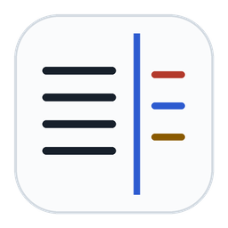
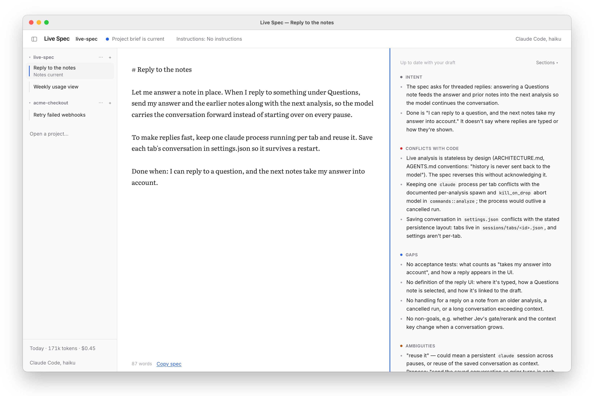
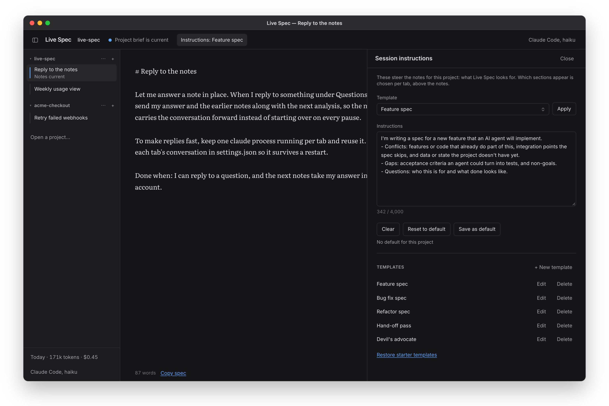
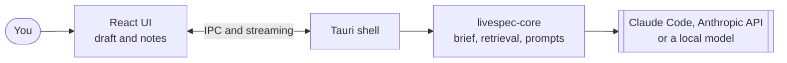

<p align="center">
  
</p>

<h1 align="center">Live Spec</h1>

<p align="center">
  <b>Write the spec before the code.</b><br>
  A desktop editor that reviews your spec against your real codebase as you type,<br>
  so the AI agent that implements it can start changing the right files without exploring or guessing first.
</p>

<p align="center">
  <a href="https://github.com/johnnycuongn/live-spec/releases/latest"></a>
  
  
  
  
  
  
</p>

<p align="center">
  <a href="https://github.com/johnnycuongn/live-spec/releases/download/v0.1.0/Live-Spec_0.1.0_aarch64.dmg"></a>
</p>

<p align="center">
  <a href="#why-live-spec">Why</a> ·
  <a href="#how-it-works">How it works</a> ·
  <a href="#install">Install</a> ·
  <a href="#quick-start">Quick start</a> ·
  <a href="#tech-stack">Stack</a> ·
  <a href="SETUP.md">Setup guide</a> ·
  <a href="ARCHITECTURE.md">Architecture</a>
</p>

<p align="center">
  
</p>

<p align="center">
  
</p>
<p align="center"><sub>Real notes from Live Spec (Claude Code, haiku) on a spec for this repo: it catches that the spec reverses the stateless design and stores per-tab data in the wrong place.</sub></p>

---

## Why Live Spec

In spec-driven development the spec comes first: you write what should be built, then an AI agent plans, breaks it into tasks and implements it. Tools such as [GitHub Spec Kit](https://github.github.com/spec-kit/) and [Kiro](https://kiro.dev/docs/specs/) organise that whole pipeline. Every later step inherits the quality of the spec.

A spec written away from the code tends to fail in predictable ways:

- **It contradicts the codebase.** It asks for something that already exists, or assumes a structure the project doesn't have.
- **It leaves gaps.** Acceptance criteria, edge cases and non-goals are missing, so the agent invents them.
- **It's ambiguous.** "Fast", "the settings page", "handle errors": the agent picks one reading, and it may not be yours.

Each of those costs you later: tokens the agent spends rediscovering the project, a plan built on a wrong guess, a review loop to undo it. Live Spec moves that work to the moment you're writing. It reads your project once, then reviews every paragraph against the real code while the spec is still cheap to change. You hand the agent a spec that already names the right files, states what done looks like, and leaves nothing to guess.

Live Spec focuses on writing the spec. When it's ready, **Copy spec** and paste it into Claude Code, Spec Kit, Kiro or any other agent.

## How it works

1. **Open the project** the spec is for. Live Spec builds a one-time *brief* of the codebase. With Claude Code, Claude explores the repo itself with read-only tools.
2. **Write.** When you pause, it retrieves the code your paragraph is about and streams review notes beside your draft.
3. **Revise** until the notes have nothing left you care about, then copy the spec to your agent.

The notes come in up to five sections. Each tab picks the ones it needs:

| Section | What it tells you |
|---|---|
| **Intent** | What the spec asks for, for whom, and what done looks like, or what it fails to say |
| **Conflicts with code** | Where the spec contradicts how the project works, re-does something that exists, or assumes wrongly, with file paths. Optionally fact-checked against the code (✓ / ✗) |
| **Gaps** | What an implementing agent would need but can't find: acceptance criteria, non-goals, edge cases, missing data, commands to run |
| **Ambiguities** | Phrases an agent would have to guess at, with both readings and a precise rewording |
| **Questions for you** | The one to three questions whose answers would change the spec most |

### Features

- **Grounded in your code.** A project brief plus per-paragraph retrieval, so the notes cite real files instead of generic advice.
- **Templates for spec types.** Feature spec, Bug fix spec, Refactor spec, Hand-off pass and Devil's advocate, each with its own instructions and sections. Write your own per project.
- **Tabs that work in parallel.** Several specs across several projects, each analysing independently, with the last five analyses kept per tab.
- **Your choice of model.** Your Claude Code subscription (default), an Anthropic API key, or a local model that never leaves your machine.
- **Optional fact-check.** With a [TypeSafe](https://typesafe.ai) key, every Conflict is checked against the code.
- **Usage you can see.** Tokens and estimated cost per day, project and kind.
- **Offline-friendly and private by design.** API keys live in the OS keychain, opened projects can't run hooks or MCP servers, and the Local option sends nothing anywhere.
- **Light and dark.** Follows your system appearance.

<p align="center">
  
</p>
<p align="center"><sub>Session instructions in dark mode: the Feature spec template steers what the notes look for in this project.</sub></p>

## Install

### macOS (Apple Silicon)

**[Download Live Spec v0.1.0 (.dmg)](https://github.com/johnnycuongn/live-spec/releases/download/v0.1.0/Live-Spec_0.1.0_aarch64.dmg)**, open it, and drag **Live Spec** into **Applications**.

The build is ad-hoc signed but not notarized, so macOS blocks the first launch. Allow it once in **System Settings → Privacy & Security → Open Anyway**, or run:

```bash
xattr -dr com.apple.quarantine "/Applications/Live Spec.app"
```

### Intel Macs, Windows and Linux

Build from source. You need Rust (stable), **Node 20.19+ or 22.12+** and the [Tauri v2 prerequisites](https://v2.tauri.app/start/prerequisites/):

```bash
git clone https://github.com/johnnycuongn/live-spec.git
cd live-spec
npm install
npm run tauri dev      # run it
npm run tauri build    # build an installer for this machine
```

See **[SETUP.md](SETUP.md)** for the full guide, tests and troubleshooting.

## Quick start

1. **Pick a model** in Settings (⌘,):

   | Provider | Setup |
   |---|---|
   | **Claude subscription** (default) | Install [Claude Code](https://docs.claude.com/en/docs/claude-code/overview) and run `claude` once to log in |
   | **Anthropic API key** | Paste a key; it's saved in the OS keychain |
   | **Local model** | Click *Install engine*, then *Download* a model |

2. **Open a project** (⌘O) and click **Build it now** for its brief.
3. **Write your spec.** Pause, and the notes appear.
4. Optional: choose **Sections ▾** for this tab, or apply a template from **Instructions**.
5. **Copy spec** and hand it to your agent.

Keyboard: ⌘T new tab · ⌘W close tab · ⌘⇧T reopen closed tab · ⌘O open project · ⌃Tab / ⌃⇧Tab switch tabs · ⌘\\ toggle sidebar · ⌘, settings. Use Ctrl instead of ⌘ on Windows and Linux.

## Tech stack

| Layer | Technology |
|---|---|
| Desktop shell | [Tauri 2](https://v2.tauri.app/) (Rust) |
| UI | React 19, TypeScript, Vite 7, Tailwind CSS v4 |
| Core | Rust library (`crates/livespec-core`) with no Tauri dependency: scanning, TF-IDF retrieval, prompts, providers, sessions |
| Models | Claude Code CLI, Anthropic Messages API, or [llama.cpp](https://github.com/ggml-org/llama.cpp) `llama-server` with GGUF models |
| Fact-check | TypeSafe Jev (optional) |
| Storage | JSON files in the app's data folder; API keys in the OS keychain |
| Tests | `cargo test` and Vitest |



Read **[ARCHITECTURE.md](ARCHITECTURE.md)** for the full picture.

## Privacy

| Provider | What leaves your machine |
|---|---|
| Claude Code | Through your own `claude` CLI to Anthropic: the files Claude reads while building the brief, then on each pause your spec, the brief and a few code snippets |
| Anthropic API | Directly to the Anthropic API with your key: a digest of the project (tree, key files, heads of central files) for the brief, then the same per-pause request |
| Local model | Nothing |
| Jev fact-check (optional, never with Local) | Your spec, each Conflict and short code excerpts, sent to TypeSafe |

Usage numbers stay on your computer.

## Documentation

| Document | What's in it |
|---|---|
| [SETUP.md](SETUP.md) | Installing, choosing a model, Claude Code restricted mode, building from source, tests, troubleshooting |
| [ARCHITECTURE.md](ARCHITECTURE.md) | Layers, the live-analysis flow, sections, project understanding, providers, persistence, security model |
| [AGENTS.md](AGENTS.md) | Rules and cross-language contracts for anyone (or any agent) changing the code |

## Contributing

Issues and pull requests are welcome. Before opening a PR, read [AGENTS.md](AGENTS.md) and run:

```bash
npm run typecheck && npx vitest run --dir src
cargo test --workspace && cargo clippy --workspace --all-targets -- -D warnings
```

## Further reading on spec-driven development

- Addy Osmani, How to write a good spec for AI agents ([blog](https://addyosmani.com/blog/good-spec/) · [Substack](https://addyo.substack.com/p/how-to-write-a-good-spec-for-ai-agents))
- GitHub, [Spec Kit](https://github.github.com/spec-kit/) and its [spec-driven development guide](https://github.com/github/spec-kit/blob/main/spec-driven.md)
- Kiro, [Specs](https://kiro.dev/docs/specs/)
